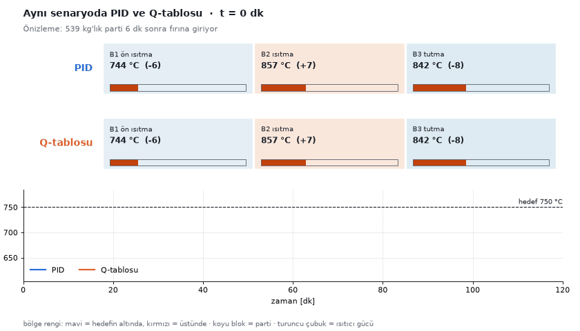
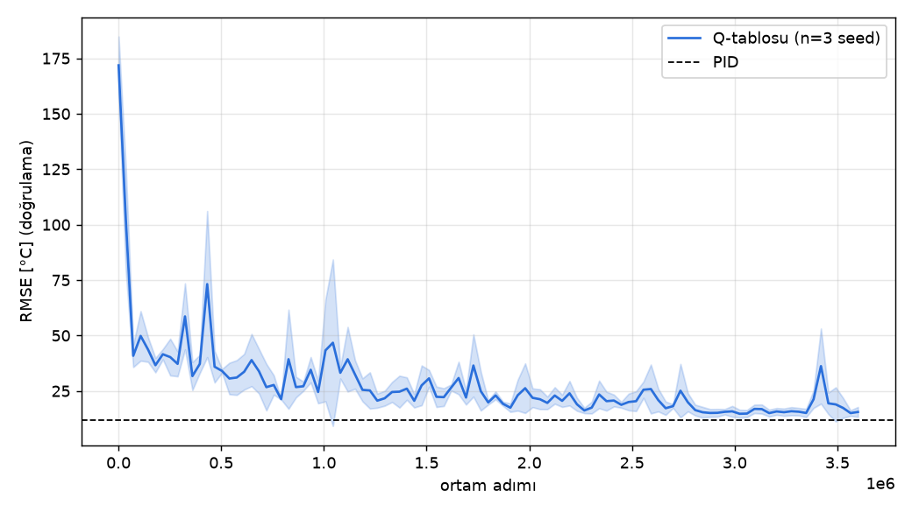
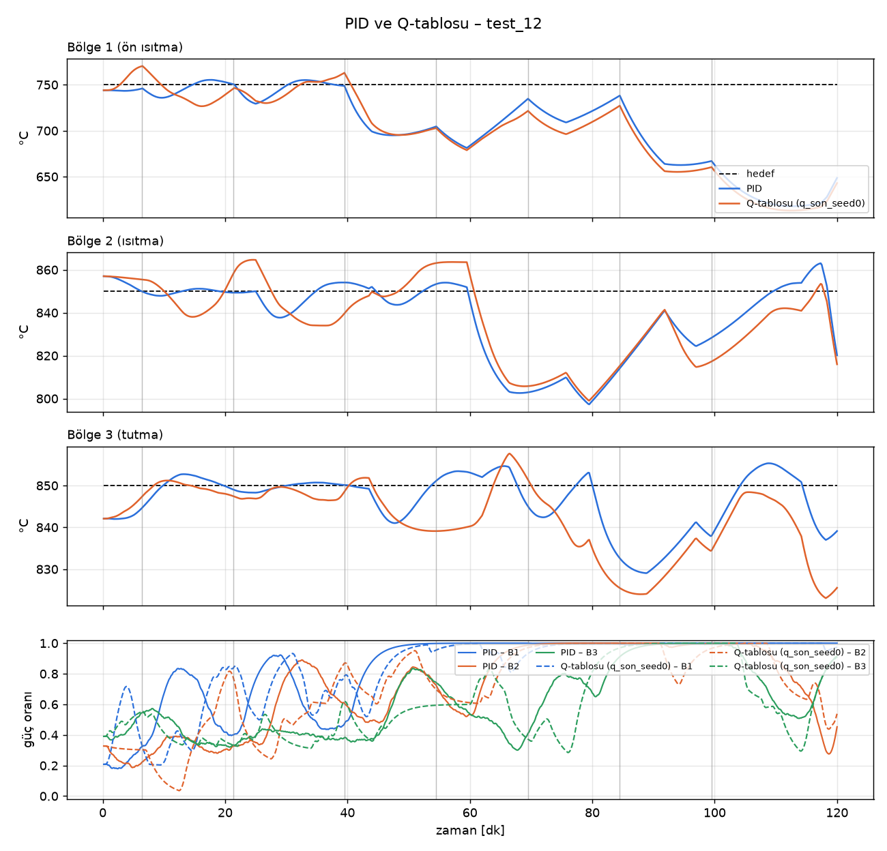
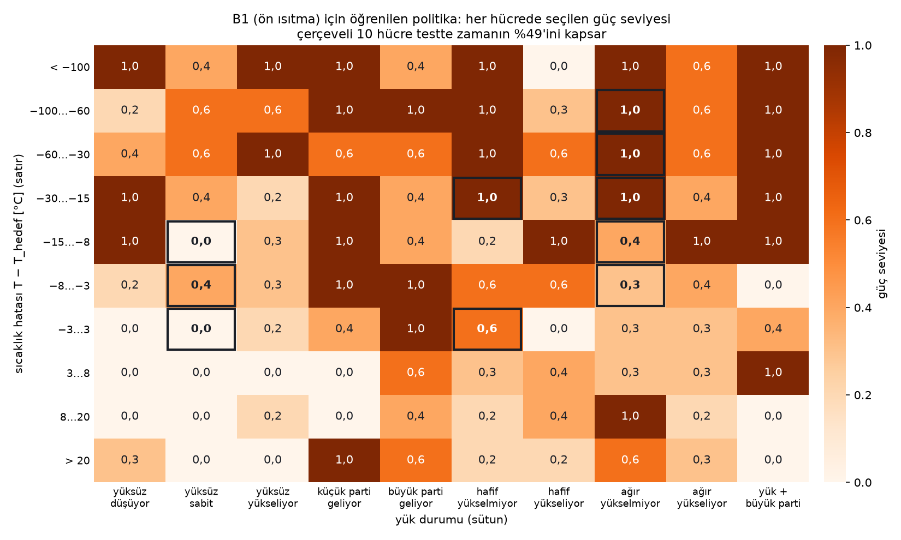

# Çok Bölgeli Tavlama Fırınında Q-Learning ile Sıcaklık Kontrolü

Bu proje, pekiştirmeli öğrenme dersi kapsamında yaptığım bir tablolu Q-Learning uygulamasıdır. Senaryo şu: sürekli
çalışan, üç bölgeli bir tavlama fırını var. Fırına bant üzerinde soğuk metal partileri giriyor ve her parti girdiğinde
bulunduğu bölgenin sıcaklığı düşüyor. Fırını yöneten ajan, ısıtıcıların gücünü klasik bir kural seti ile değil, deneme
yanılma yoluyla, aldığı cezalardan öğrenerek ayarlıyor.

Amaç hem RL'in temel kavramlarını (state, action, reward, Q-Table, epsilon-greedy) gerçekçi bir endüstriyel problem
üzerinde uygulamak hem de eğitilmiş ajanı sanayide yaygın kullanılan klasik **PID** kontrolcüyle sayısal olarak
karşılaştırmaktı. Dersin şartı gereği derin pekiştirmeli öğrenme kullanmadım; projede sinir ağı yok.

**Video anlatım:** VIDEO_LINKI_BURAYA_  GELCEK



Aynı test senaryosunda (2 saatte 7 soğuk parti) üstte PID, altta benim eğittiğim Q-tablosu fırını yönetiyor.

## Çalıştırma

```bash
python -m venv .venv
.venv/Scripts/python -m pip install -r requirements.txt
.venv/Scripts/python -m pip install -e .
.venv/Scripts/python -m pytest -q
```

Eğitilmiş Q-tabloları depoda olduğu için PID ile karşılaştırmayı eğitim yapmadan çalıştırabilirsiniz (yaklaşık 1 dakika):

```bash
.venv/Scripts/python scripts/compare_e3.py --runs results/models/q_son_seed0 results/models/q_son_seed1 results/models/q_son_seed2 --tag e3
```

Tek bir eğitim normal bir laptopta tek çekirdekte yaklaşık 45 dakika sürüyor:

```bash
.venv/Scripts/python -m furnace_rl.agents.q_table --seed 0 --config configs/q_table_son.yaml --env-config configs/env_w_energy_1.0.yaml --name q_son_seed0
```

Bütün eğitimleri ve grafikleri baştan üretmek için `bash scripts/run_experiments.sh 7` ve
`bash scripts/run_evaluations.sh 7`. Çıktılar şuralara düşüyor:

- `results/models/q_son_seed*/best_model.npz` → eğitilmiş Q-tabloları
- `results/eval/` → sonuç tabloları
- `results/figures/` → grafikler, politika şekli ve animasyon

## Problem Tanımı

Fırın, sıcaklığı ayrı ayrı kontrol edilen üç bölgeden oluşuyor. Partiler soldan girip bant üzerinde sağa doğru ilerliyor:

```
              B1 ön ısıtma        B2 ısıtma           B3 tutma
           +-----------------+-----------------+-----------------+
 parti --> |  hedef 750 °C   |  hedef 850 °C   |  hedef 850 °C   | --> çıkış
           |  en çok 250 kW  |  en çok 200 kW  |  en çok 160 kW  |
           +-----------------+-----------------+-----------------+
                  5 m               5 m               5 m
```

Partiler 300–1500 kg arasında, rastgele zamanlarda (ortalama 35 dakikada bir) geliyor. Bir parti girdiğinde bulunduğu
bölgeden ısı çekiyor ve sıcaklık düşüyor; buna termal çöküş deniyor.

Ajanın hedefi:

- Her bölgenin sıcaklığını hedefte tutmak
- Enerji tüketimini artırmamak
- 950 °C güvenlik sınırını hiç aşmamak

Problemi zorlaştıran şey fırının yavaşlığı. Isıtıcıya "gücü artır" komutu verildiğinde 30 saniye boyunca hiçbir şey
olmuyor (ölü zaman), ısıtıcı yeni gücüne ancak birkaç dakikada ulaşıyor (150 s zaman sabiti), sıcaklık sensörü de 20
saniye geç ve ±1 °C gürültüyle ölçüyor. Hatayı gördükten sonra tepki veren bir kontrolcü bu yüzden hep geç kalıyor.
Öte yandan gelecek partinin kütlesi ve hızı tesiste 10 dakika önceden biliniyor (önizleme); ajan bu bilgiyi görüyor.

Gerçek bir fırında deneme yanılma yapılamayacağı için fırının bir simülatörünü `gymnasium.Env` olarak yazdım
(`src/furnace_rl/envs/furnace_env.py`). İçinde her bölgenin enerji dengesi, ısıtıcı gecikmesi, partilerin ısınıp
ilerlemesi ve gürültülü sensör var. Parametreleri gerçek bir fırından almadım, kalibre ettim: ilk ayarlarda PID
partinin yarattığı düşüşü 17 °C ile sınırlayabiliyordu, yani problem öğrenmeye yer bırakmayacak kadar kolaydı. Son
ayarda 1 tonluk bir parti kontrolsüz fırında sıcaklığı 175 °C, PID ile 34 °C düşürüyor.

## Aksiyonlar

Her bölgenin ajanı her kararda 6 güç seviyesinden birini seçiyor:

| ID | Aksiyon | Açıklama |
|---|---|---|
| 0 | Güç 0 | Isıtıcıyı kapat |
| 1 | Güç 0,2 | Düşük güç |
| 2 | Güç 0,3 | |
| 3 | Güç 0,4 | Yüksüz bölgeyi hedefte tutmaya yakın güç |
| 4 | Güç 0,6 | |
| 5 | Güç 1,0 | Tam güç |

Burada dikkat edilmesi gereken bir nokta var: seçilen seviyeye güç bir anda çıkmıyor, adım başına en çok %10
değişerek gidiyor. Bunu bilinçli yaptım, çünkü gerçek bir ısıtıcı ya da gaz vanası da bir anda tam açılıp kapanmaz.
Karşılaştırmanın adil olması için PID de aynı sınırla çalışıyor.

Ajan her 10 saniyede değil, **30 saniyede bir** karar veriyor. Bir komutun etkisi ölü zaman ve ısıtıcı gecikmesi
yüzünden ancak bu kadar sonra görülmeye başlıyor; her adımda karar verseydi eyleminin sonucunu göremeden yeni karar
vermiş olurdu. 60 saniyeyi de denedim, doğrulamada 30 saniye biraz daha iyi çıktı (13,75'e karşı 14,15 °C).

## State Tasarımı

State tasarımı bu projede en çok uğraştığım konu oldu, çünkü tablolu Q-Learning state sayısına çok hassas.

Simülatör her adımda 30 sayılık bir gözlem veriyor: üç bölgenin sıcaklık hataları ve değişim hızları, hedefler,
önceki komutlar, bölgelerdeki yük, ısıtıcıların gerçek gücü, yolda bekleyen komutlar ve gelecek partinin bilgisi.
Bunların hepsini tabloya koymak istesem, her birini yalnızca 10 kutuya bölsem bile:

```
10^30 farklı state  →  bellekte tutulamaz, ömür boyu eğitsem hücrelerin çoğu hiç görülmez
```

Bu yüzden her bölgeye ayrı, küçük bir tablo verdim ve state'i iki eksene indirdim:

```
state = (sıcaklık_hatası_kutusu, yük_durumu)
```

| Bileşen | Aralık | Boyut |
|---|---|---|
| sıcaklık hatası kutusu | 0..9 | 10 |
| yük durumu | 0..9 | 10 |

Bölge başına state sayısı 10 × 10 = 100. Q-tablosu bölge başına 100 × 6 = 600 hücre, üç bölgede toplam **1800 sayı**.

**Sıcaklık hatası** (ölçülen − hedef) 10 kutuya bölündü. Kutular hedefin yakınında dar, uzağında geniş; çünkü ince
ayar hedefin yakınında gerekiyor, hedefin 100 °C altındayken yapılacak tek şey zaten tam güç:

| Kutu | Aralık [°C] | Anlamı |
|---|---|---|
| 0 | < −100 | Çok soğuk |
| 1–4 | −100…−60 · −60…−30 · −30…−15 · −15…−8 | Hedefin altında |
| 5 | −8…−3 | Biraz soğuk |
| 6 | −3…3 | Hedefte |
| 7–8 | 3…8 · 8…20 | Hedefin üstünde |
| 9 | > 20 | Çok sıcak |

**Yük durumu** 10 sınıf:

| Sınıf | Anlamı |
|---|---|
| 0, 1, 2 | Yük yok; sıcaklık düşüyor / sabit / yükseliyor |
| 3, 4 | Yük yok; küçük / büyük parti yaklaşıyor |
| 5, 6 | Hafif yük; sıcaklık yükselmiyor / yükseliyor |
| 7, 8 | Ağır yük; sıcaklık yükselmiyor / yükseliyor |
| 9 | Yük var ve büyük parti yaklaşıyor |

1. bölgeye yaklaşan parti önizlemeden, 2. ve 3. bölgeye yaklaşan yük bir önceki bölgeden okunuyor.

### Bu tasarıma nasıl vardım

İlk denememde state dört eksenliydi (hata, değişim hızı, yük, yaklaşan yük) ve ajan 11 güç seviyesinden seçiyordu.
Tablo bölge başına 9 680 hücreydi ve ajan neredeyse hiçbir şey öğrenemedi. Tabloyu küçülttükçe her hücre daha sık
güncellendi ve sonuç iyileşti:

| Durum temsili | Hücre (bölge başına) | Doğrulama sapması |
|---|---|---|
| 11 hata × 5 hız × 4 yük × 4 yaklaşan yük | 9 680 | 73,5 °C |
| 14 × 5 × 4 × 4, ziyarete göre azalan α | 12 320 | 34,7 °C |
| 14 × 5 × 3 × 3 | 6 930 | 24,8 °C |
| **10 hata × 10 yük durumu** | **600** | **13,3 °C** |
| 10 hata × 10 değişim hızı (yük yok) | 600 | 22,3 °C |
| PID (karşılaştırma) | – | 11,9 °C |

Son satır da önemli bir şey öğretti: yük bilgisini çıkarıp yerine değişim hızını koyduğumda sonuç belirgin kötüleşti.
Bölge iki farklı sebeple soğuyabiliyor: içeride soğuk bir parti olduğu için (tam güç gerekir) ya da yüksüzken ısıtıcı
kısık kaldığı için (biraz güç yeter). Yükü görmeyen tablo bu iki durumu aynı hücrede görüyor ve birinde yanılıyor.

Bütün bu seçimleri yalnızca 5 doğrulama senaryosuna bakarak yaptım; 20 test senaryosunu en sona sakladım.

### Bu tasarımın bedeli

State'te ısıtıcının o anki gerçek gücü yok. Bunu eklemek tabloyu katlıyordu ve yukarıdaki tablodaki gibi öğrenmeyi
yavaşlatıyordu. Bedeli şu: ajan ısıtıcının zaten tam güçte olduğunu bilmiyor. Aynı hücre hem "ısıtıcı tam güçte,
sıcaklık birazdan yükselecek" hem de "ısıtıcı kapalı" durumlarını içeriyor. Sonuçlarda gördüğüm aşmanın (hedefin
üstüne çıkmanın) büyük kısmı buradan geliyor.

## Reward Fonksiyonu

Ödül her 10 saniyede veriliyor ve her zaman sıfır ya da negatif; yani bir ceza puanı. Ajan bu cezayı en aza indirmeye
çalışıyor. Sıfır en iyisi: sıcaklık tam hedefte, enerji harcanmıyor.

```math
r_t = -\left( w_1 \frac{1}{N}\sum_{i} e_{i,t}^2 + w_2 \frac{E_t}{E_{\max}} + w_3 \frac{1}{N}\sum_{i} |u_{i,t} - u_{i,t-1}| \right) - c\,\mathbf{1}\left[\max_i T_{i,t} > 950\,^\circ\mathrm{C}\right]
```

| Terim | Ağırlık | Örnek | Neden |
|---|---|---|---|
| Sıcaklık sapması, e = (T − hedef) / 20 °C, karesi | w₁ = 1 | 10 °C sapma: 0,25 · 40 °C sapma: 4 | Ana görev; büyük düşüşler kare yüzünden çok sert cezalanıyor |
| Enerji (harcanan / tam güçteki) | w₂ = 0,2 | Tüm ısıtıcılar tam güçte: 0,2 | Ödevin istediği enerji hedefi |
| Güç değişimi | w₃ = 0,05 | Genelde çok küçük | Isıtıcının sürekli açılıp kapanmasını önlemek |
| 950 °C üstünde geçen her adım | c = 2 | | Güvenlik |

Örnek bir adım: 1. bölge hedefin 10 °C altında, 2. bölge hedefte, 3. bölge 5 °C üstünde, ısıtıcılar %40 güçte.
Sıcaklık cezası (0,25 + 0 + 0,06) / 3 ≈ 0,10, enerji cezası 0,2 × 0,4 = 0,08, o adımın ödülü yaklaşık −0,18.
2 saatlik bir bölüm 720 adım; test senaryolarında bölüm toplamı PID'de ortalama −886, Q-tablosunda −1134.

Her bölgenin tablosu kendi payını alıyor: kendi sıcaklık sapması, kendi ısıtıcısının enerjisi ve kendi güç değişimi.

### Reward Tasarımında Aldığım Dersler

İlk olarak, bölümün ne zaman bittiği de ödülün bir parçası. İlk tasarımda 950 °C aşılınca bölümü bitirip tek
seferlik bir ceza vermeyi düşünmüştüm. Hesapladığımda bunun bir açık olduğunu gördüm: ödül hep negatif olduğu için
bölümü erken bitirmek, kalan adımların cezasından kurtulmak demek. Isıtıcıları tam güçte tutan basit bir kural bölümü
ortalama 97. adımda bitirip −700 alıyordu; fırını düzgün işleten PID ise tüm bölümde −886 alıyor. Yani fırını kasten
aşırı ısıtmak daha "kârlı" görünüyordu. Bu yüzden son tasarımda sınır aşımı bölümü bitirmiyor, aşımın sürdüğü her adım
ayrı cezalanıyor.

İkinci olarak, enerji ağırlığı beklediğim gibi davranmadı. w₂'yi büyütünce ajanın ısıtıcıları kısıp sıcaklıktan
vazgeçmesini bekliyordum. Öyle olmadı: enerji neredeyse hiç değişmedi (674–687 kWh), çünkü enerjinin büyük kısmını
duvar kayıpları ve partilerin ısıtılması belirliyor. Asıl değişen sıcaklık takibi oldu, hem de ters yönde: enerji
cezası olmayan ajan en kötüsüydü.

| Enerji ağırlığı | Sapma (RMSE) | Enerji |
|---|---|---|
| w₂ = 0 | 30,1 °C | 674 kWh |
| w₂ = 0,2 | 24,1 °C | 686 kWh |
| w₂ = 1 | 22,1 °C | 687 kWh |

Kaba ızgarada aynı hücreye düşen eylemleri ayırt etmeye yarayan ek bir işaret gibi davrandığını düşünüyorum, ama bunu
ayrıca test etmedim. Bu sonuç yüzünden son ayarda ajanı w₂ = 1 ile eğittim.

Üçüncü olarak, güç değişimi cezasını (w₃) sıfırlayınca titreşim artmadı. Ajan bir seviyeyi 30 saniye tuttuğu ve güç
seviyeye %10'luk adımlarla gittiği için titreşim zaten düşüktü.

Genel olarak şunu öğrendim: bir ödül teriminin etkisi, ona verdiğim ağırlıktan ve benim ne amaçladığımdan tahmin
edilemiyor. Ajanın o terimi gerçekten ne kadar değiştirebildiği daha belirleyici.

## Q-Learning Algoritması

Klasik Q-Learning güncellemesi kullanıldı. Tek fark, ajan 30 saniyede bir karar verdiği için ödülün 3 adımlık toplamı
ve γ'nın 3. kuvveti kullanılıyor:

```math
Q(s,a) \leftarrow Q(s,a) + \alpha(s,a)\left[R + \gamma^{k} \max_{a'} Q(s',a') - Q(s,a)\right], \qquad R = \sum_{j=0}^{k-1} \gamma^{j}\, r_{t+j},\ k = 3
```

- Q(s, a) → o state'te o güç seviyesini seçmenin tahmini değeri (bundan sonra toplanacak ceza)
- α → öğrenme oranı, yeni bilgiye ne kadar güvenildiği
- γ → gelecekteki cezaların bugünkü karara ne kadar etki ettiği
- R → karar süresince toplanan ödül
- max Q(s′, a′) → yeni state'te yapılabilecek en iyi seçimin değeri

k = 1 olduğunda bu, derste gördüğümüz güncellemenin aynısı. Kod: `src/furnace_rl/agents/q_table.py`, `train` fonksiyonu.

### Hiperparametreler

| Parametre | Değer | Notum |
|---|---|---|
| Öğrenme oranı (α) | max(0,02; 0,5 / (1 + n/20)) | n o hücrenin kaç kez güncellendiği. Az görülen hücre hızlı, çok görülen kararlı öğreniyor. Bu değişiklikle (ve 14 hata kutusuyla) doğrulama sapması 73,5'ten 34,7 °C'ye indi |
| α'nın alt sınırı | 0,02 | 0,05'i de denedim, test sapması 24,1'den 25,3 °C'ye kötüleşti |
| İndirim faktörü (γ) | 0,99 (adım başına) | Yaklaşık 17 dakikalık bir ufuk; ısıtıcı gecikmesini ve bir partinin etkisini kapsıyor |
| Başlangıç Q değeri | −5 | Ödüller negatif; tablo 0 ile başlasaydı hiç denenmemiş eylemler en iyi görünürdü |
| Karar periyodu | 30 s | 60 s'den doğrulamada biraz iyi |
| Episode sayısı | 5000 (3,6 milyon adım) | ε 4000. bölümde en alta inince eğri düzleşiyor |
| Seed | 0, 1, 2 | Sonucun şans eseri olmadığını görmek için |

### Epsilon-Greedy Exploration

Her kararda ε olasılıkla rastgele bir güç seviyesi seçiliyor, (1 − ε) olasılıkla tablodaki en iyi seviye.

- Başlangıçta ε = 0,3
- İlk 4000 bölümde doğrusal olarak 0,02'ye iniyor
- Son 1000 bölümde ε = 0,02

Daha fazla keşif (ε 0,5 → 0,05) denediğimde test sapması 24,1'den 26,3 °C'ye kötüleşti.

## Eğitim Süreci

`src/furnace_rl/agents/q_table.py` çalıştırıldığında sırasıyla:

1. Her bölge için 100 × 6'lık Q-tablosu −5 ile başlatılır.
2. 5000 bölüm boyunca eğitim yapılır. Her bölüm rastgele bir parti takvimiyle 2 saatlik bir fırın çalışmasıdır:
   - Ajan 30 saniyede bir her bölge için ε-greedy ile güç seviyesi seçer
   - Seviye 3 adım uygulanır, ödüller toplanır, tablo güncellenir
3. Her 50 bölümde bir, 5 doğrulama senaryosunda (ε = 0) denenir; en iyi tablo `best_model.npz` olarak kaydedilir.
4. Aynı eğitim 3 farklı seed ile tekrarlanır.
5. Seçilen tablolar ve PID, eğitimde hiç kullanılmamış 20 test senaryosunda karşılaştırılır.

Karşılaştırma için her bölgeye ayrı bir PID kurdum (`src/furnace_rl/baselines/pid.py`). Ayarlarını 90 farklı
kombinasyonu deneyerek seçtim. Yalnızca ödüle bakan arama, yüksüzken bile sıcaklığı ±7–14 °C salındıran ayarları
seçiyordu; sahada kabul edilmeyecek bir şey. Bu yüzden yüksüz adım yanıtında salınımın 2 °C'nin altında olması şartını
ekledim; 90 ayarın 21'i bu şartı sağladı. Seçilen: Kp = 0,04, Ti = 300 s, Td = 60 s.

## Sonuçlar

### Öğrenme eğrisi



| Eğitim anı | Doğrulama sapması (3 seed ortalaması) |
|---|---|
| Başlangıç | ≈ 172 °C |
| 500. bölüm | ≈ 32 °C |
| 2000. bölüm | ≈ 21 °C |
| 5000. bölüm | ≈ 15 °C |
| En iyi tablolar | 13,75 °C |
| PID | 11,9 °C |

Başta tablo rastgele olduğu için ajan fırını hiç yönetemiyor. İlk birkaç yüz bölümde hızla iyileşiyor, ε en alta
indikten sonra eğri düzleşiyor ve üç seed birbirine yaklaşıyor. Ama kesikli çizgideki PID'in altına inmiyor.

### Q-Learning ve PID karşılaştırması

Eğitimde hiç kullanılmayan 20 test senaryosunda (her biri 2–7 soğuk parti içeren 2 saatlik çalışma):

| Metrik | PID | Q-tablosu (3 seed) |
|---|---|---|
| Ortalama sapma (RMSE) | **19,2 °C** | 22,4 ± 1,0 °C |
| En büyük düşüş | **68,4 °C** | 70,9 °C |
| Aşma (hedefin üstüne çıkma) | **16,1 °C** | 27,6 °C |
| Enerji | 690 kWh | **686 kWh** |
| Isıtıcı titreşimi | 0,052 | **0,028** |
| 950 °C ihlali | 0 | 0 |

Q-tablosu PID'i geçemedi: ortalama sapması %17 daha büyük, aşması belirgin şekilde fazla. Buna karşılık aynı enerjiyi
harcıyor, ısıtıcıyı yarı yarıya daha az oynatıyor (gerçek bir vanada daha az aşınma) ve güvenlik sınırını hiç
aşmıyor. Üç seed'in sonuçları birbirine çok yakın (±1 °C), yani öğrenme kararlı.



En ağır senaryoda (2 saatte 7 parti) 1. bölgede iki kontrolcü birbirine yakın, çünkü ısıtıcı ikisinde de uzun süre
tam güçte. Fark 2. ve 3. bölgede: Q-tablosu hedef etrafında daha çok salınıyor.

### Öğrenilen politika



Tablolu Q-Learning'in güzel bir yanı, öğrenilen politikanın doğrudan okunabilmesi. Şekil, 1. bölgenin tablosunda her
hücrede seçilen güç seviyesini gösteriyor; çerçeveli hücreler testte en çok vakit geçen 10 hücre (zamanın %49'u).

- Ağır yük altında ve hedefin 15 °C'den fazla altındayken tam güç (1,0) veriyor; mantıklı.
- Yüksüz ve hedefteyken (−3…3, "yüksüz sabit") gücü **0**'a çekiyor, biraz soğuyunca (−8…−3) **0,4**'e çıkıyor.

Sıcaklığı hedefte sabit tutan güç yaklaşık 0,35, yani iki seviyenin arasında. Ajan ikisi arasında gidip geliyor ve
sıcaklık hedef etrafında salınıyor. PID ise sürekli bir güç ürettiği için 0,35'i tam verebiliyor. PID'e kaybetmenin
ana sebebi bence bu.

Özetle PID'i geçememesinin üç sebebi var:

1. **Kaba ızgara:** Doğru güç iki seviyenin arasında kalıyor.
2. **Isıtıcının gerçek gücü tabloda yok:** Ajan ısıtıcının zaten tam güçte olduğunu bilmiyor; parti çıkınca sıcaklık
   hedefin üstüne çıkıyor.
3. **Önizleme kullanılamadı:** "Parti yaklaşıyor" durumu tabloda çok seyrek görülüyor; ajan partiyi önceden görüp
   fırını hazırlamayı öğrenemedi.

### Diğer deneyler

| Deney | Sonuç |
|---|---|
| Sensör gürültüsü 0 → 5 °C (yeniden eğitim yok) | Q-tablosunun sapması 21,5'ten 26,0 °C'ye, PID'inki 18,8'den 20,3 °C'ye çıkıyor. Hedefe yakın kutular 5–6 °C genişliğinde; gürültü ölçümü komşu kutuya atıp seçilen gücü değiştiriyor |
| Tek ağır parti (1500 kg) | Q-tablosu PID'den iyi: 19,2'ye karşı 21,0 °C, düşüş 63'e karşı 78 °C. "Ağır yük, hedefin çok altı" hücresinde hemen tam güce geçiyor |
| Eğitimde görülmemiş 2500 kg parti | Q-tablosu biraz iyi: 57,5'e karşı 58,6 °C |
| Yavaş bant (0,05 m/dk) | Q-tablosu kötü: aşma 60 °C. Uzun süre hedefte durmak gerekince salınım baskın oluyor |
| Gelecek parti bilgisi olmadan eğitim | Sonuç değişmedi (24,0'a karşı 24,1 °C) |

## Görselleştirme

En üstteki animasyon, aynı test senaryosunu PID ve Q-tablosu ile adım adım çalıştırıp her 50 saniyeyi bir kareye
çevirerek üretildi (`scripts/make_gif.py`). Animasyonda şunlar görülüyor:

- **Bölge rengi:** hedeften sapma; mavi hedefin altında, gri hedefte, kırmızı hedefin üstünde
- **Koyu bloklar:** fırından geçen partiler (yükseklik kütleyle orantılı)
- **Turuncu çubuk:** ısıtıcının o anki gücü
- **Üst yazı:** zaman ve sıradaki partinin önizlemesi
- **Alttaki grafik:** 1. bölgenin sıcaklığı, iki kontrolcü için

## Gözlemler

Eğitim sonunda ajanın şunları öğrendiğini gözlemledim:

- **Ağır yükte hızlı tepki:** Soğuk parti girip sıcaklık hızla düşerken hemen tam güce geçiyor. Tek ağır partide bu
  yüzden PID'den iyi.
- **Az titreşim:** Isıtıcıyı PID'in yarısı kadar oynatıyor.
- **Güvenlik:** 20 test senaryosunun hiçbirinde 950 °C aşılmadı.
- **Hedefte salınım:** Yukarıda anlattığım 0 ile 0,4 arasında gidip gelme.

Beklemediğim bir şey: ajan gelecek partiyi 10 dakika önceden görmesine rağmen bu bilgiyi kullanmayı öğrenemedi.
Önizlemeyi çıkarıp eğittiğim ajanla aynı sonucu verdi, partiden önce gücü artırma davranışı da yok. Sanırım
"parti yaklaşıyor" hücreleri çok seyrek görüldüğü ve önceden ısıtmanın faydası birkaç karar sonra geldiği için kaba
bir tablo bu işareti ayırt edemedi.

Bir de az görülen hücrelerdeki değerler (örneğin "yüksüz ve hızla ısınıyor, hata < −100") seed'den seed'e değişiyor;
o hücreler yeterince güncellenmemiş.

## Karşılaştığım Zorluklar

**Tabloyu ne kadar küçültmeli:** Çok büyük tutunca ajan öğrenemedi, çok küçültünce ince kontrol yapamıyor. 10 × 10
ortayı buldu, ama PID'i geçmeye yetmedi. Bu projenin bence ana dersi bu.

**Simülatörü ayarlamak:** İlk ayarlarda problem çok kolaydı, PID zaten iyi iş çıkarıyordu. Gücü azaltınca bu kez fırın
yetersiz kaldı ve en iyi ve en kötü PID ayarı aynı sonucu verdi. Gerçekçi ama çözülebilir bir ortayı bulmak birkaç
deneme sürdü.

**Eğitim süresi:** Her eğitim yaklaşık 45 dakika. Bütün deneyler (33 eğitim) 7 paralel işle 4–5 saat sürdü; bu yüzden
deneyleri arka planda kuyrukla çalıştırdım.

**İşe yaramayan denemeler:** Eğitimde büyük sapmaların cezasını sınırlamayı denedim (ceza kırpma); sonucu kötüleştirdi,
kullanmadım.

**Sonucun PID'in gerisinde kalması:** Testte Q-tablosunun PID'i geçemediğini görünce bir iyileştirme turu yaptım
(farklı güç seviyeleri, 30 s karar, w₂ = 1). Sapma 24,1'den 22,4 °C'ye indi, seed'ler arası fark 4,0'dan 1,0 °C'ye
düştü, ama PID'e ulaşmadı. Ayarları test sonucuna bakarak değiştirmedim, sonucu olduğu gibi yazdım.

## Proje Yapısı

```
tavlama-firini-rl/
│
├── README.md
├── requirements.txt, pyproject.toml
│
├── configs/
│   ├── q_table_son.yaml        # son Q-tablosu ayarı
│   ├── q_table.yaml            # referans ayar (karşılaştırma deneyleri)
│   ├── env_*.yaml              # ödül ağırlığı ve önizleme deneyleri
│   ├── pid.yaml                # PID kazançları
│   └── test_scenarios.json     # 20 test senaryosu
│
├── src/furnace_rl/
│   ├── config.py               # simülatörün tüm fiziksel ayarları
│   ├── envs/furnace_env.py     # fırın simülatörü (gymnasium.Env): reset, step, ödül
│   ├── envs/scenarios.py       # rastgele parti takvimleri
│   ├── agents/q_table.py       # Q-Table, state kodlama, epsilon-greedy, eğitim döngüsü
│   ├── baselines/pid.py        # karşılaştırma için PID
│   ├── evaluate.py             # bir politikayı senaryolarda çalıştırma
│   ├── metrics.py              # sapma, düşüş, aşma, enerji
│   └── plots.py                # grafikler
│
├── scripts/                    # deneyleri, grafikleri ve animasyonu üreten betikler
├── tests/                      # 18 otomatik test
├── docs/                       # tasarım notları ve sprint kayıtları
└── results/
    ├── models/q_son_seed*/     # eğitilmiş Q-tabloları
    ├── eval/                   # sonuç tabloları
    └── figures/                # grafikler, politika şekli, animasyon
```

Modülleri ayırırken ortam ile ajanın birbirini bilmemesine dikkat ettim: yalnızca gözlem ve eylem üzerinden
konuşuyorlar. Bu sayede aynı ortamda hem PID'i hem Q-tablosunu aynı değerlendirme koduyla çalıştırabildim. Testlerden
biri, kodda sinir ağı kütüphanesi (torch, tensorflow vb.) olmadığını da otomatik denetliyor.

## Sınırlamalar

- **Simülatör:** Parametreler gerçek bir fırından değil, kalibrasyondan geliyor. Sayılar bu simülasyon için geçerli.
- **Kaba ızgara:** 6 güç seviyesi ve 10 hata kutusu, PID'in sürekli gücü kadar ince kontrol yapamıyor.
- **Eksik state bilgisi:** Isıtıcının gerçek gücü ve yolda bekleyen komutlar tabloda yok.
- **Bağımsız bölgeler:** Her bölge kendi tablosunu öğreniyor; bölgeler arası ısı geçişini birbirlerinin kararı olarak
  değil, ortamın bir parçası olarak görüyorlar.
- **Eğitim süresi:** 3,6 milyon adım, gerçek fırında yaklaşık 417 günlük çalışma demek; sahada ancak simülatörde eğitip
  aktarmak düşünülebilir.

## Sonuç

Bu projede pekiştirmeli öğrenmeyi, derste gördüğümüz tablolu Q-Learning ile gerçek bir endüstriyel problemin benzetimine
uygulamaya çalıştım. Ajan fırını kontrol etmeyi öğrendi: aynı enerjiyle, daha az titreşimle ve güvenlik sınırını hiç
aşmadan çalışıyor. Ama ortalama sapmada PID'i geçemedi (22,4'e karşı 19,2 °C).

En çok şunu öğrendim: tablolu Q-Learning'de algoritma kadar state tasarımı önemli. Tablo büyürse öğrenilemiyor, küçülürse
ince kontrol yapılamıyor. Öğrenilen tabloya bakarak bunun nedenini doğrudan görebilmek de bence projenin en değerli
kısmı oldu.
