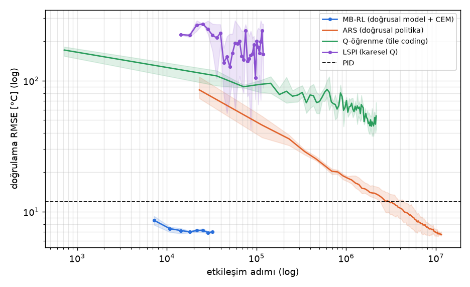
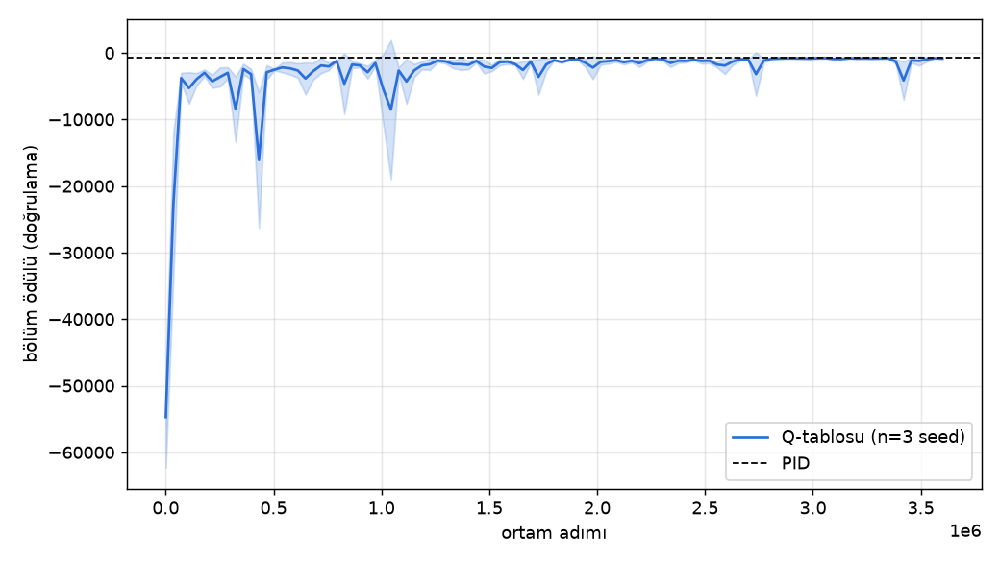
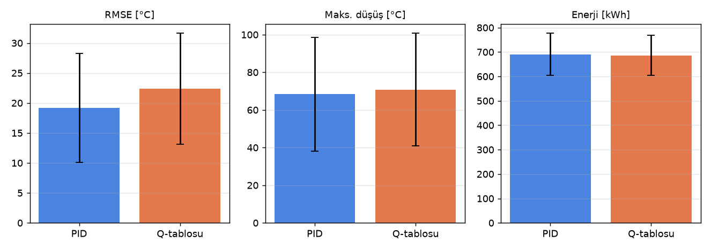
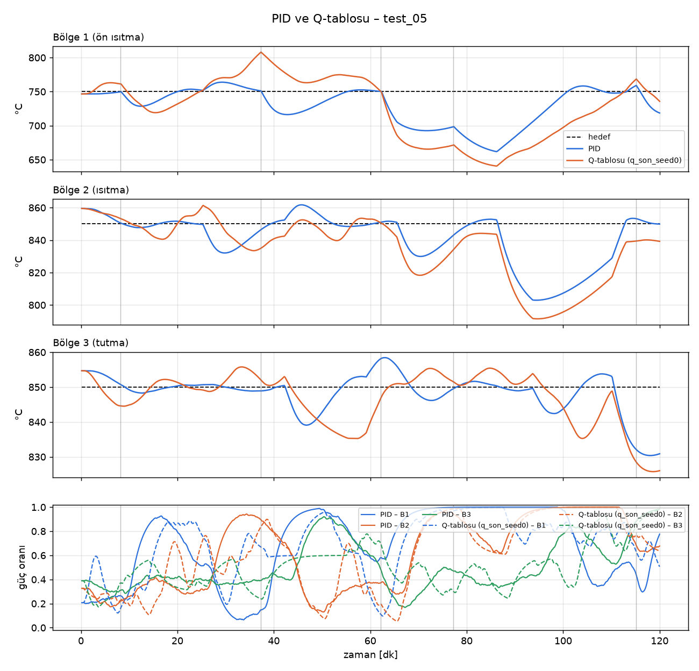
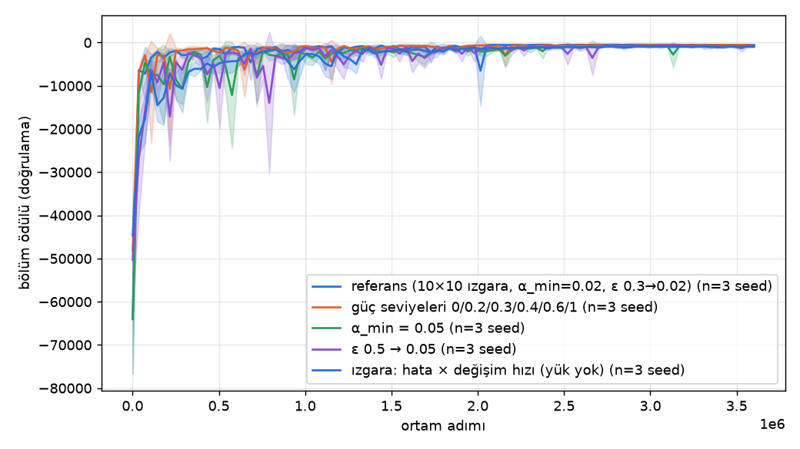
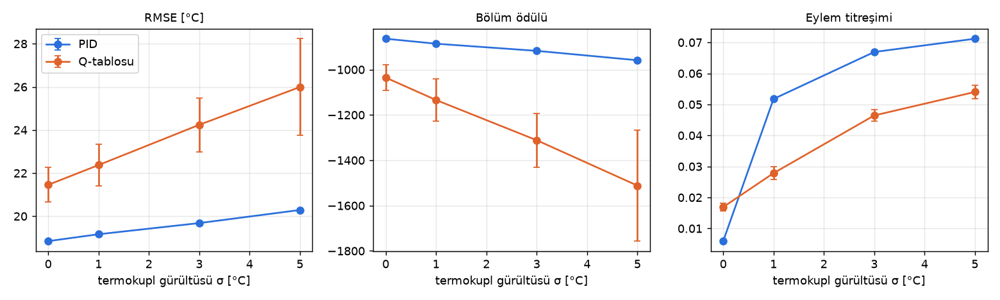
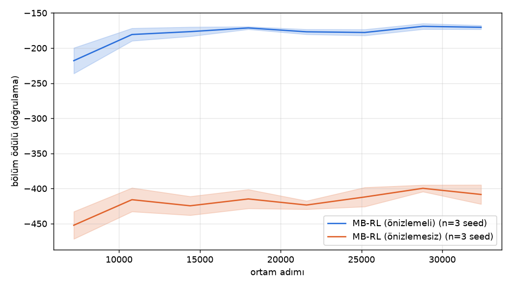
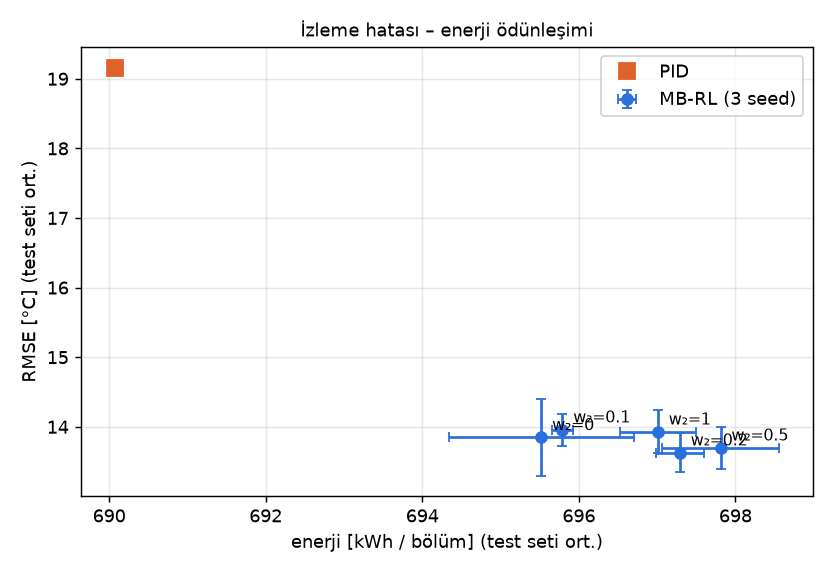
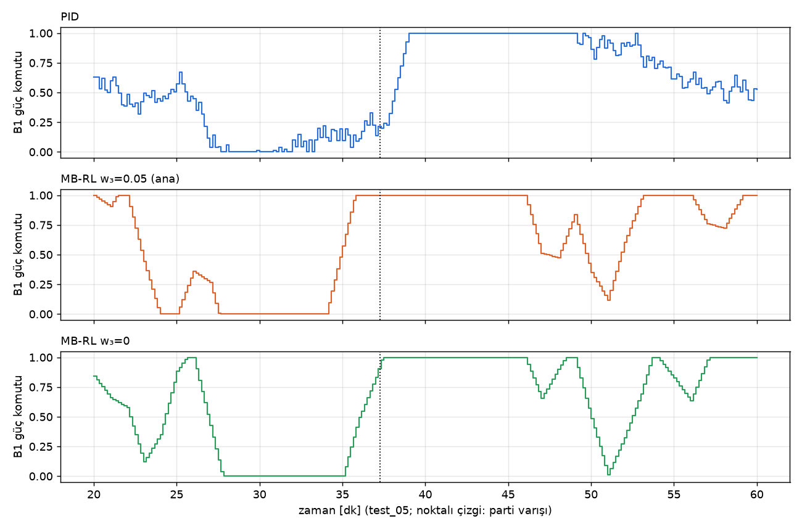

# Çok Bölgeli Tavlama Fırınında Pekiştirmeli Öğrenme ile Sıcaklık ve Enerji Optimizasyonu

*Yüksek lisans Pekiştirmeli Öğrenme dersi ödevi*

**Video anlatım:** VIDEO_LINKI_BURAYA

## Özet

Sürekli çalışan çok bölgeli tavlama fırınlarında soğuk parti girişi bölge sıcaklığında ani bir düşüşe yol açar. Fırının ısıl
eylemsizliği nedeniyle geri beslemeli kontrolcüler bu düşüşü ancak hata oluştuktan sonra telafi edebilir. Bu çalışmada üç
bölgeli bir fırın için `gymnasium` tabanlı, fizik temelli bir simülatör geliştirilmiş, problem Markov karar süreci olarak
formüle edilmiş ve sinir ağı içermeyen model tabanlı bir pekiştirmeli öğrenme ajanı (MB-RL) eğitilmiştir. Ajan fırının geçiş
modelini ridge regresyonla öğrenir ve gelecek parti bilgisini de kullanarak çapraz entropi yöntemiyle planlama yapar.
Eğitimde kullanılmayan 20 test senaryosunda, 3 seed ortalamasıyla ve ızgara aramasıyla ayarlanmış PID'e göre bölüm ödülü
%41.0, RMSE %28.9 (19.16 °C'den 13.63 °C'ye), en büyük sıcaklık düşüşü %26.7 (68.4 °C'den 50.1 °C'ye) iyileşmiştir. Buna
karşılık aşma %16.4, enerji tüketimi %1.0 artmış, B1 toparlanma süresi 4.7 dakika uzamıştır. Gelecek parti bilgisi gözlemden
çıkarıldığında ajan PID'in gerisine düşmektedir. PID'e bu bilgi verilmediği için kıyasta MB-RL lehine bir bilgi farkı vardır.

**Anahtar kelimeler:** pekiştirmeli öğrenme, model tabanlı RL, çapraz entropi yöntemi, tavlama fırını, süreç kontrolü, PID

## 1. Giriş ve endüstriyel problem

Sürekli çalışan metal ısıl işlem fırınları, malzemeyi sıcaklığı ayrı ayrı denetlenen ardışık
bölgelerden geçirerek hedef sıcaklık profiline getirir. Fırına soğuk bir parti girdiğinde malzeme
bulunduğu bölgeden hızla ısı çeker ve bölge sıcaklığı düşer (termal çöküş). Isıtıcıların ve fırın
duvarının yüksek ısıl eylemsizliği nedeniyle klasik PID kontrolcü bu düşüşü ancak hata oluştuktan
sonra fark eder. Telafisi geç kalır, geç kalınca da doyuma girip aşma yapar.

Fırına girmek üzere olan partinin kütlesi ve hızı tesisin izleme sisteminde önceden bilinir. Bu
çalışmada bu bilgiyi kullanabilen bir pekiştirmeli öğrenme ajanı eğitilmiş ve aynı ortamda ayarlanmış
bir PID kontrolcüyle karşılaştırılmıştır.

**Yöntem seçimi.** Ödev metni "TD3 veya model tabanlı RL (PETS / MPC-RL)" önermektedir. Dersin
şartı derin pekiştirmeli öğrenme kullanılmamasıdır. TD3 ve PETS sinir ağı kullandığı için bu şartı
sağlamaz. Bu nedenle önerinin model tabanlı RL kolu sinir ağı olmadan uygulanmıştır: ajan fırının
geçiş modelini etkileşim verisinden doğrusal regresyonla öğrenir ve bu modelle planlama yapar. Bu
yöntem bu metinde MB-RL olarak anılır. Bu depodaki hiçbir yöntem sinir ağı kullanmaz.

### 1.1 İlgili çalışmalar

Endüstriyel sıcaklık kontrolünde PID yaygın bir çözümdür (Åström & Hägglund, 2006). Ölü zamanın ve kısıtların önemli olduğu
proseslerde ise bir modelle ileriye bakan ve kayan ufukta karar veren model öngörülü kontrol (MPC) kullanılır (Camacho &
Bordons, 2007). Model tabanlı RL bu fikri, modeli etkileşim verisinden öğrenerek uygular. PETS (Chua vd., 2018) dinamiği
olasılıksal bir sinir ağı topluluğuyla öğrenir ve eylemleri çapraz entropi yöntemiyle (Rubinstein & Kroese, 2004) planlar.
Modelden bağımsız tarafta fonksiyon yaklaştırmalı Q-öğrenme (Sutton & Barto, 2018), en küçük kareler tabanlı politika
iterasyonu (Lagoudakis & Parr, 2003) ve doğrusal politikalar üzerinde rastgele arama (Mania vd., 2018) bu çalışmada
karşılaştırma için kullanılan yaklaşımlardır. Bu çalışma PETS'in veri toplama, model öğrenme ve planlama döngüsünü izler,
ancak sinir ağı yerine ridge regresyonla öğrenilen doğrusal bir model kullanır.

## 2. MDP formülasyonu

Problem, ayrık zamanlı bir Markov karar süreci $(S, A, P, R, \gamma)$ olarak modellenmiştir. Kontrol
adımı Δt = 10 s, bölüm uzunluğu 720 adımdır (2 saatlik çalışma). İndirim faktörü γ = 0.99 seçilmiştir.
Bu değerin efektif ufku yaklaşık 100 adım (≈ 17 dk) olup ısıtıcı gecikmesini ve bir partinin
bölgedeki ısınma süresinin başlangıcını kapsar.

**Kısmi gözlemlenebilirlik.** Gerçek sistem kısmen gözlemlenebilir: termokupl gecikmeli ve
gürültülü ölçer, partinin iç sıcaklığı ölçülemez, ısıtıcı komutları gecikmeyle etki eder. Gözleme
sıcaklık türevi, bölge yük bilgisi, ısıtıcının fiili gücü ve ölü zamanda bekleyen komutlar eklenerek
durum Markov özelliğine yaklaştırılmış ve MDP varsayımıyla çalışılmıştır.

### 2.1 Durum uzayı S

N = 3 bölge için 30 boyutlu, normalize gözlem vektörü:

*Tablo 1. Gözlem vektörünün bileşenleri.*

| Bileşen | Boyut | Anlamı |
|---|---|---|
| (T_meas,i − T_ref,i) / 25 | 3 | Ölçülen sıcaklığın hedeften sapması |
| (dT_i/dt) / 10 | 3 | Filtrelenmiş sıcaklık değişim hızı (°C/dk) |
| T_ref,i / 1000 | 3 | Hedef profil |
| u_i,t−1 | 3 | Bir önceki güç komutu |
| m_bölge,i / 1500 | 3 | Bölgede bulunan malzeme kütlesi |
| m_next / 1500, v_next / 0.3, t_varış / 600 | 3 | Önizleme: gelecek parti (10 dk ufuk) |
| u_eff,i | 3 | Isıtıcının fiili gücü (güç ölçeri) |
| u_{t−3}, u_{t−2}, u_{t−1} | 9 | Ölü zamanda bekleyen komutlar |

Ödev tanımındaki "bölge sıcaklıkları, türevleri, gelecek malzemenin kütlesi ve hızı" doğrudan
karşılanmıştır. Diğer bileşenler Markov özelliği için eklenmiştir. Bir güç komutu 30 s ölü zamandan
sonra ve 150 s zaman sabitiyle ısıtıcıya ulaştığından, yalnızca son komutu gören bir ajan önceki
komutların ne kadarının hâlâ "yolda" olduğunu bilemez. Fiili ısıtıcı gücü sahada güç ölçeriyle ölçülür,
bekleyen komutlar ise kontrolcünün kendi geçmişidir.

### 2.2 Eylem uzayı A

Fiziksel eylem her bölgenin rezistans güç oranıdır (ya da doğalgaz oransal vana açıklığı),
$u \in [0,1]^3$. Ajan ise güçteki değişimi seçer (artımlı / velocity biçimi):

```math
a_t \in [-1,1]^3, \qquad u_t = \mathrm{clip}(u_{t-1} + 0.1\,a_t,\ 0,\ 1)
```

Artımlı biçimin sebebi fırının yüksek statik kazancıdır: $\Delta T = P_{\max}\,\Delta u / h \approx 200\ \mathrm{kW} \cdot 0.01 / (75\ \mathrm{W/K}) \approx 27\,^\circ\mathrm{C}$, yani güç çıkışındaki %1'lik hata kalıcı durumda yaklaşık 27 °C sapma yaratır. Artımlı
biçimde kalıcı durum için ajanın yalnızca sıfır üretmesi yeterlidir. Adil kıyas için PID de aynı
±%10/adım sınırıyla çalıştırılmıştır.

### 2.3 Geçiş dinamiği P

Geçişler, Bölüm 3'teki fizik tabanlı fark denklemleriyle belirlenir. Stokastik bileşenler: parti
varış zamanları (Poisson), parti kütlesi ve hızı (düzgün dağılım), ortam sıcaklığı (bölüm başında)
ve sensör gürültüsü (Gauss). Ajan bu denklemleri görmez, geçişi veriden öğrenir (Bölüm 4.2).

### 2.4 Ödül fonksiyonu R

```math
r_t = -\left( w_1 \frac{1}{N}\sum_{i=1}^{N} e_{i,t}^2 + w_2 \frac{E_t}{E_{\max}} + w_3 \frac{1}{N}\sum_{i=1}^{N} |u_{i,t} - u_{i,t-1}| \right) - c\,\mathbf{1}\left[\max_i T_{i,t} > 950\,^\circ\mathrm{C}\right]
```

```math
e_{i,t} = \frac{T_{i,t} - T_{\mathrm{ref},i}}{20\,^\circ\mathrm{C}}
```

Burada $E_t$ adımda harcanan enerji (kWh), $E_{\max}$ tüm ısıtıcılar tam güçteyken adım başına harcanan enerjidir.
Ağırlıklar $w_1 = 1.0$, $w_2 = 0.2$, $w_3 = 0.05$; güvenlik cezası $c = 2$ olup 950 °C üstünde geçen her adım için uygulanır.

Ödev "hedef profilden sapma karesi ve enerji ile ters orantılı" bir ödül istemektedir. Negatif
ağırlıklı maliyet bu koşulu sağlar ve planlayıcının toplamsal maliyet olarak doğrudan kullanmasına
izin verir. Terimler normalize edildiği için ağırlıklar doğrudan öncelik anlamı taşır. Üçüncü terim
vana ya da rölenin sürekli açılıp kapanmasını (chattering) cezalandırır.

Ödülde gerçek bölge sıcaklığı kullanılmıştır, gürültülü ölçüm değil. Bu, simülasyonun sağladığı
bir ayrıcalıktır: gürültünün ödüle karışmasını önler. Ajan yalnızca gürültülü ölçümü gözler.

### 2.5 Ödül şekillendirmenin olası yan etkileri

**Sonlandırma açığı.** Ödül her adımda negatif olduğundan, 950 °C aşımında bölümü bitiren ve tek
seferlik ceza veren bir tasarım, bölümü kısaltmayı ödüllendirir. Bu açık eğitim yapılmadan doğrudan
ölçülmüştür (`scripts/reward_analysis.py`). Isıtıcıları tam güçte tutan sabit bir kural, tek seferlik
10 puan cezayla bölümü ortalama 97. adımda bitirerek −700 ödül almaktadır. Fırını düzgün işleten PID
ise tüm bölümde −886 almaktadır. Bu nedenle ortamda ihlal bölümü bitirmez, ihlal süren her adım
cezalandırılır. Sonlandırma koşulu da ödülün bir parçasıdır.

**Kare hata ve ısı depolama.** Kare hata büyük düşüşleri sert cezalandırdığı için bir ajanın bölgeyi
sürekli hedefin üstünde tutması beklenebilirdi. MB-RL'de bu görülmemiştir. B1 yüksüz dönemlerde hedefin
ortalama ~1 °C altında, varıştan önceki 10 dakikada ortalama ~3 °C altında kalır (PID'de −3 ve −12 °C).
Ajan kalıcı bir ısı deposu tutmak yerine gücü varıştan kısa süre önce artırır (Bölüm 5.3).

**Beklenen ama gözlenmeyen yan etki: enerji–sıcaklık ödünleşimi.** w₂ çok büyükse ajanın ısıtıcıları
kısarak hedef sıcaklıktan vazgeçeceği, w₂ = 0 olursa enerjiyi umursamayacağı beklenmişti. E4 taraması
(Bölüm 5.8) bunu doğrulamamıştır. Enerji tüketimi büyük ölçüde fizik tarafından belirlenir: ajanın
değiştirebildiği küçük enerji payının kazancı, aynı sapmanın izleme maliyetinin yaklaşık 70'te biridir.
Bir terimin davranışı etkileyebilmesi için ağırlığı kadar ajanın o terimi ne ölçüde değiştirebildiği de
önemlidir. Benzer biçimde w₃ = 0 ile eylem titreşimi artmamıştır.

## 3. Simülasyon ortamı

Ortam `gymnasium.Env` arayüzüyle yazılmıştır (`src/furnace_rl/envs/furnace_env.py`). Her bölge
tek bir ısıl kütle olarak modellenmiştir. Fizik 2 s'lik alt adımlarla Euler yöntemiyle çözülür.

**Aktüatör** (ısıl eylemsizlik ve ölü zaman; τ_a = 150 s, d = 30 s):

```math
u^{\mathrm{eff}}_{i,t+1} = u^{\mathrm{eff}}_{i,t} + \frac{\Delta t}{\tau_a}\left(u_{i,t-d} - u^{\mathrm{eff}}_{i,t}\right)
```

**Bölge enerji dengesi:**

```math
C\,\frac{dT_i}{dt} = P_{\max,i}\,u^{\mathrm{eff}}_i - h\,(T_i - T_{\mathrm{amb}}) + k\,(T_{i-1} - T_i) + k\,(T_{i+1} - T_i) - \sum_j Q_j
```

**Parti ısınması** (parti $v_j$ hızıyla ilerler, her 5 m'de bir sonraki bölgeye geçer):

```math
Q_j = hA_m\,m_j\,(T_i - T_{m,j}), \qquad m_j c_m \frac{dT_{m,j}}{dt} = Q_j
```

**Termokupl** (τ_tc = 20 s):

```math
T^{\mathrm{tc}}_{t+1} = T^{\mathrm{tc}}_t + \frac{\Delta t}{\tau_{\mathrm{tc}}}\left(T_t - T^{\mathrm{tc}}_t\right), \qquad T^{\mathrm{meas}}_t = T^{\mathrm{tc}}_t + \mathcal{N}(0, \sigma^2)
```

Parametreler ve kalibrasyon: `docs/03_simulator_tasarimi.md` §3. Kalibrasyonun amacı, problemin
ne PID'in kolayca çözebileceği kadar kolay (ilk denemede düşüş 17 °C) ne de fırın kapasitesi
yetmediği için hiçbir kontrolcünün fark yaratamayacağı kadar zor olmasıydı. Son ayarda 1 tonluk
parti kontrolsüz fırında 175 °C, ayarlı PID ile 36 °C düşüşe yol açmaktadır.

## 4. Yöntemler

### 4.1 Baseline: bölge başına PID

Ayrık PID; anti-windup (koşullu integrasyon), ölçüm üzerinden filtreli türev ve bumpless başlangıç
içerir. Kazançlar, test setinden farklı 10 senaryoda RL ile aynı ödül fonksiyonu üzerinden 90
kombinasyonluk ızgara aramasıyla seçilmiştir. Yalnızca ödüle bakan arama yük yokken bile salınan
ayarları seçtiği için kararlılık şartı eklenmiştir (yüksüz adım yanıtında salınım < 2 °C).
PID, RL ajanlarıyla aynı ±%10/adım güç değişim sınırıyla çalışır. Kazançlar: Kp = 0.04 /°C,
Ti = 300 s, Td = 60 s. PID yalnızca karşılaştırma ölçütüdür, ajanın eğitimine ve kararlarına karışmaz.

### 4.2 Ana yöntem: model tabanlı RL (MB-RL)

Yöntem, PETS'in (Chua vd., 2018) veri toplama–model öğrenme–planlama döngüsünü izler. PETS'teki sinir ağı topluluğu
yerine ridge regresyonla öğrenilen doğrusal bir model kullanılır (`src/furnace_rl/agents/mbrl.py`).

1. **Keşif.** İlk 10 bölümde politika yoktur: başlangıç gücü etrafında 60 s boyunca sabit tutulan
   rastgele eylemler uygulanır.
2. **Model öğrenme.** Toplanan tüm `(s, a, s')` geçişlerinden model yeniden kestirilir.
3. **Planlama ve yeni veri.** Ajan bu modelle planlayarak 5 bölüm daha oynar (üstüne σ = 0.1 keşif
   gürültüsü eklenir), veri büyür, 2. adıma dönülür. Toplam 8 tur, 45 bölüm, 32 400 adım.

**Öğrenilen model:**

```math
e_{t+1} = e_t + W \left[e_t,\ u^{\mathrm{eff}}_t,\ l_t,\ 1\right]^\top + b_t
```

```math
u^{\mathrm{eff}}_{i,t+1} = \alpha_i\,u^{\mathrm{eff}}_{i,t} + \beta_i\,u_{i,t-d}
```

İlk denklem üç bölgenin sıcaklık hatasını, ikincisi bölge başına ısıtıcı gecikmesini tanımlar. $W$ katsayıları ridge
regresyonun kapalı çözümüyle hesaplanır:

```math
W = \left(X^\top X + \lambda I\right)^{-1} X^\top Y
```

Burada $X$'in satırları $[e_t,\ u^{\mathrm{eff}}_t,\ l_t,\ 1]$, $Y$'nin satırları $e_{t+1} - e_t$ değerleridir.

$l_t$ bölge yükü ve yeni giren kütleyi izleyen üstel süzgeçtir (ρ = 0.995). Partinin iç
sıcaklığı ölçülemediği için ısı çekişi bu özellikle temsil edilir. $b_t$ son model hatalarının kayan
ortalamasıdır (bozucu kestirimi).

**Planlama.** Her 60 s'de çapraz entropi yöntemi (CEM; Rubinstein & Kroese, 2004) ile 10 dakikalık eylem dizisi aranır. Her turda
200 aday dizi öğrenilmiş modelle benzetilir, en düşük maliyetli %10'una göre dağılım güncellenir (4 tur).
Dizinin ilk parçası uygulanır, sonraki adımda plan yenilenir (kayan ufuk). Önizlemedeki parti varış
anında B1 yüküne eklenir, böylece ajan henüz gelmemiş partiyi planına katar.

**Ajanın bildikleri ve öğrendikleri.** Ödül fonksiyonu tasarımcı tarafından tanımlandığı için planlayıcı
onu bilir (PETS'te de böyledir). Ölü zaman adım sayısı, ±%10 eylem sınırı ve partinin B1'den girdiği
tasarım bilgisi olarak verilmiştir. Isıl kapasite, kayıp, iletim, ısı transferi ve aktüatör zaman
sabiti ajana verilmez, veriden öğrenilir. Öğrenilen model fizikle tutarlıdır: gerçek değeri 0.9355 olan
ısıtıcı katsayısı α 0.9351 kestirilmiştir, güçten sıcaklığa kazançlar gerçek değerlerin %81–94'üdür.

*Tablo 2. MB-RL hiperparametreleri.*

| Hiperparametre | Değer |
|---|---|
| Model düzenlileştirmesi λ | 1e-3 |
| Taze yük süzgeci ρ | 0.995 |
| Bozucu kestirimi süzgeci | 0.05 |
| Planlama ufku H / yeniden planlama | 60 adım (10 dk) / 6 adım (60 s) |
| CEM nüfus / seçkin / tur / σ | 200 / %10 / 4 / 0.5 |
| γ | 0.99 |
| Keşif gürültüsü | σ = 0.3 (ilk tur), 0.1 (sonra) |
| Toplam | 32 400 adım (45 bölüm), seed 0, 1, 2 |

Her tur sonunda model, test setinden ayrı 5 doğrulama senaryosunda değerlendirilmiş, en yüksek ödüllü
model saklanmıştır. Bir seed'in eğitimi tek CPU çekirdeğinde 6–7 dakika sürmektedir.

### 4.3 Karşılaştırma yöntemleri

Ana yöntemin seçimini desteklemek için sinir ağı içermeyen üç yöntem daha aynı ortamda, 3 seed ile
denenmiştir. Üçü de modelden bağımsızdır.

- **Q-öğrenme, tile coding** (Sutton & Barto, Bölüm 10; `q_tile.py`): bölge başına bağımsız ajan, 7 ayrık
  güç değişimi, 60 s karar periyodu, 5 boyutlu durum, 8 tiling, ε-greedy. 3000 bölüm.
- **LSPI** (Lagoudakis & Parr, 2003; `lspi.py`): karesel özelliklerle doğrusal Q, LSTD-Q ile politika
  değerlendirme, kapalı biçimde politika iyileştirme.
- **ARS, doğrusal politika** (Mania vd., 2018; `ars.py`): 15 özellikli doğrusal politikanın parametreleri
  üzerinde rastgele yönlerle sonlu fark gradyanı. Ödev değerlendirmesinde rastgele arama klasik yöntem sayıldığı için
  ana RL yöntemi olarak değil, karşılaştırma olarak sunulmuştur.

## 5. Deneyler ve sonuçlar

Test sonuçları eğitimde kullanılmayan 20 senaryodandır (her biri 2–7 soğuk parti içeren 2 saatlik
çalışma, aynı seed'ler). Hiperparametreler test sonuçlarına bakılarak değiştirilmemiştir.

### 5.1 Yöntem karşılaştırması

*Tablo 3. 20 test senaryosunda yöntem karşılaştırması (3 seed ortalaması).*

| Yöntem | Eğitim adımı | Test ödülü | RMSE [°C] | Maks. düşüş [°C] | Aşma [°C] | Enerji [kWh] |
|---|---|---|---|---|---|---|
| PID (baseline) | – | −885.9 | 19.16 | 68.4 | 16.1 | 690 |
| **MB-RL** | **32 400** | **−522.4** | **13.63** | **50.1** | 18.8 | 697 |
| ARS | 11 520 000 | −466.8 | 12.66 | 45.8 | 22.2 | 698 |
| Q-öğrenme, tile coding | 2 160 000 | −8209.8 | 62.43 | 155.8 | 66.9 | 623 |
| LSPI | 118 800 | −9027.0 | 66.29 | 165.7 | 97.1 | 622 |



*Şekil 1. Doğrulama RMSE'si – etkileşim adımı (iki eksen logaritmik), 3 seed ortalaması ve min–maks bandı.*

İki sonuç öne çıkmaktadır. Birincisi, ARS testte MB-RL'den biraz iyidir (RMSE 12.66'ya karşı 13.63 °C),
ancak yaklaşık 355 kat daha fazla etkileşim kullanmıştır. Doğrulama RMSE'si PID'in altına ARS'ta 2.4–4.5
milyon adımda, MB-RL'de ilk değerlendirmede (7200 adım) inmiştir. İkincisi, değer tabanlı iki klasik yöntem
PID'in çok gerisinde kalmıştır. Olası bir sebep, tek bir 10 saniyelik eylemin Q değerine etkisinin Q'nun genel
büyüklüğüne göre çok küçük olması, dolayısıyla eylemler arasındaki farkın zor öğrenilmesidir. LSPI'de Q'nun eylem
eğriliğinin yanlış işarete döndüğü ve kazançların dağıldığı gözlenmiştir. Q-öğrenme 60 s karar periyoduna ve ayarlı
başlangıç değerine rağmen 3000 bölümde PID düzeyine ulaşamamıştır.

### 5.2 Öğrenme eğrileri (E2)

MB-RL'in doğrulama ödülü ilk modelden (10 rastgele bölüm, 7200 adım) sonra PID'i geçer: RMSE 7.9–9.3 °C.
İkinci turdan sonra yataylaşır. Seed'ler arası fark küçüktür (en iyi RMSE 6.78–7.00 °C, ödül −165 ile −172
arası; PID: 11.93 °C, −364).



*Şekil 2. MB-RL doğrulama ödülü, 3 seed ortalaması ± std, kesikli çizgi PID.*


*Şekil 3. MB-RL doğrulama RMSE'si, 3 seed ortalaması ± std, kesikli çizgi PID.*

### 5.3 PID ile karşılaştırma (E3)

*Tablo 4. 20 test senaryosunda PID ve MB-RL.*

| Metrik | PID | MB-RL (3 seed ort. ± std) | Fark |
|---|---|---|---|
| Bölüm ödülü | −885.9 ± 730.2 | **−522.4 ± 18.0** | %41.0 daha iyi |
| RMSE | 19.16 ± 9.10 °C | **13.63 ± 0.28 °C** | %28.9 daha iyi |
| Maks. düşüş | 68.4 ± 30.2 °C | **50.1 ± 0.9 °C** | %26.7 daha iyi |
| Aşma | **16.1 ± 5.3 °C** | 18.78 ± 0.45 °C | %16.4 daha kötü |
| B1 toparlanma (±5 °C) | **20.5 dk** | 25.2 dk | daha kötü |
| Enerji | **690 kWh** | 697 kWh | %1.0 daha fazla |
| Eylem titreşimi (ort. \|Δu\|) | 0.052 | **0.027** | %47.6 daha iyi |
| Varış öncesi 3 dk'da B1 güç artışı | −0.12 | **+0.30** | |
| 950 °C ihlali | 0 dk | 0 dk | |

PID sütunundaki std senaryolar arası, MB-RL sütunundaki std seed'ler arasıdır. MB-RL, 20 senaryonun
tamamında PID'den yüksek ödül ve düşük RMSE almıştır (senaryo başına RMSE farkı 1.25–9.17 °C).



*Şekil 4. 20 test senaryosunda RMSE, maksimum düşüş ve enerji (PID ve MB-RL).*

**Önceden ısıtma.** Bir parti varmadan önceki 3 dakikada MB-RL, B1 gücünü 7–10 dakika önceki seviyesine
göre ortalama 0.30 artırır. PID aynı aralıkta gücü 0.12 azaltır, çünkü henüz hata görmemiştir. Örneğin
test_05'te art arda gelen partilerde PID'in B1 sıcaklığı 662 °C'ye kadar inerken MB-RL'inki 680–683 °C'de
kalır (Şekil 5). En ağır senaryoda (test_12, 2 saatte 7 parti) fark daralır: PID 618 °C, MB-RL 625 °C.
Burada B1 ısıtıcısı zamanın %77'sinde tam güce yakındır ve fark fırın kapasitesiyle sınırlıdır.

Toparlanma süresinin uzaması, ajanın partiler arasında sapmayı tamamen kapatmak yerine gelecek ödülle
dengelemesiyle tutarlı görünmektedir, ama bu ayrıca test edilmemiştir.



*Şekil 5. test_05 senaryosu: bölge sıcaklıkları ve güç komutları, PID ve MB-RL (en iyi seed).*

### 5.4 Hiperparametre analizi (E5)

Her ayar 3 seed ile eğitilmiş, referanstan tek fark o ayardır. Değerler 20 test senaryosundandır
(std: seed'ler arası).

*Tablo 5. Hiperparametre analizi.*

| Ayar | Test ödülü | RMSE [°C] | Maks. düşüş [°C] | Aşma [°C] |
|---|---|---|---|---|
| **Referans** (H = 60, λ = 1e-3, nüfus 200, ρ = 0.995) | **−522.4 ± 18.0** | 13.63 ± 0.28 | 50.1 | 18.8 |
| Ufuk H = 30 (5 dk) | −617.5 ± 17.0 | 15.00 ± 0.27 | 55.0 | 14.9 |
| Ufuk H = 120 (20 dk) | −542.4 ± 16.8 | 14.33 ± 0.34 | 51.0 | 26.2 |
| Yeniden planlama 30 s | −521.5 ± 16.7 | 13.55 ± 0.25 | 49.1 | 17.5 |
| CEM nüfusu 50 | −532.3 ± 16.1 | 13.80 ± 0.25 | 50.2 | 19.4 |
| Bozucu kestirimi yok | −526.0 ± 10.4 | 13.63 ± 0.13 | 49.8 | 19.1 |
| Taze yük ρ = 0.99 | −548.6 ± 49.9 | 14.04 ± 0.83 | 51.1 | 19.6 |
| Taze yük ρ = 0.999 | −539.8 ± 21.3 | 14.00 ± 0.36 | 51.3 | 18.4 |
| Ridge λ = 1 | −558.3 ± 9.1 | 14.22 ± 0.12 | 51.7 | 18.6 |

En belirgin etki planlama ufkundadır. 5 dakikalık ufuk 10 dakikalık önizlemenin tamamını kullanamaz ve
düşüş artar. 20 dakikalık ufuk ise ödülü iyileştirmez ve aşmayı 26 °C'ye çıkarır. Muhtemel sebepler, modelin bu kadar
uzun tahminde daha çok hata biriktirmesi ve önizlemeden sonraki partileri zaten görememesidir. Daha sık yeniden
planlama ve bozucu kestirimi seed değişkenliği içinde kalan farklar üretmiştir. Yani bu problemde bozucu
kestirimi gerekli görünmemektedir. Bu ayar sade tutulabilirdi.



*Şekil 6. Hiperparametre analizi: doğrulama ödülü, 3 seed ortalaması.*

### 5.5 Sensör gürültüsüne gürbüzlük (E6)

Yeniden eğitim yapılmadan, termokupl gürültüsü σ ∈ {0, 1, 3, 5} °C ile 20 test senaryosu:

*Tablo 6. Termokupl gürültüsüne gürbüzlük.*

| σ [°C] | PID RMSE | MB-RL RMSE (3 seed) | PID ödül | MB-RL ödül | PID titreşim | MB-RL titreşim |
|---|---|---|---|---|---|---|
| 0 | 18.84 | **13.47** | −864 | **−520** | 0.006 | 0.028 |
| 1 (eğitim) | 19.16 | **13.63** | −886 | **−522** | 0.052 | **0.027** |
| 3 | 19.68 | **14.58** | −917 | **−570** | 0.067 | **0.028** |
| 5 | 20.29 | **15.81** | −959 | **−632** | 0.071 | **0.030** |

MB-RL her gürültü düzeyinde PID'den iyidir, ama gürültüden etkilenmez değildir. σ = 5 °C'de RMSE'si
2.3 °C artar, PID'inki 1.4 °C. Mutlak üstünlük korunur, fark 5.4 °C'den 4.5 °C'ye iner. Buna karşılık eylem
titreşimi neredeyse sabittir: planlayıcı eylemi 60 s tutar ve maliyeti uzun ufukta değerlendirir, PID'de ise
türev terimi gürültüyü doğrudan güce yansıtır (0.006'dan 0.071'e).



*Şekil 7. Termokupl gürültüsü arttıkça RMSE, ödül ve eylem titreşimi (eğitim σ = 1 °C).*

### 5.6 Dağılım dışı senaryolar (E7)

*Tablo 7. Eğitimde görülmemiş senaryolar.*

| Senaryo | PID RMSE | MB-RL RMSE | PID düşüş | MB-RL düşüş | PID aşma | MB-RL aşma |
|---|---|---|---|---|---|---|
| Tek ağır parti (1500 kg) | 21.0 | **13.0** | 77.8 | **40.9** | **15.3** | 21.7 |
| 2500 kg parti (eğitimde en çok 1500) | 58.6 | **47.9** | 181.9 | **144.5** | **15.1** | 33.8 |
| 8 dk arayla iki parti (eğitimde en az 15) | 42.3 | **34.9** | 144.8 | **121.2** | 15.1 | **12.3** |
| Hızlı bant 0.4 m/dk (eğitimde en çok 0.3) | 10.0 | **8.4** | 38.8 | **36.5** | **16.5** | 22.0 |
| Yavaş bant 0.05 m/dk (eğitimde en az 0.1) | 6.2 | **2.9** | 37.1 | **6.9** | **7.3** | 11.7 |

MB-RL, eğitimde görmediği koşulların hepsinde RMSE ve düşüşte PID'den iyidir. Doğrusal model yük kütlesine göre
dışa doğru genellemeyi kolaylaştırmış olabilir, ancak bu tek bir deneyle kesinleşmez. Aşma 5 senaryonun 4'ünde
PID'den büyüktür. 2500 kg partide 33.8 °C'ye çıkar.

### 5.7 Önizleme ablasyonu (E8)

Gözlemden gelecek partinin bilgisi çıkarılarak aynı seed ve ayarlarla eğitim yapılmıştır
(`configs/env_no_preview.yaml`). Ajan hâlâ bölgedeki mevcut yükü görür, yalnızca henüz gelmemiş partiyi
göremez.

*Tablo 8. Önizleme ablasyonu.*

| Metrik | PID | MB-RL önizlemesiz | MB-RL önizlemeli |
|---|---|---|---|
| Bölüm ödülü | −885.9 | −971.7 ± 38.8 | **−522.4 ± 18.0** |
| RMSE [°C] | 19.16 | 20.30 ± 0.43 | **13.63 ± 0.28** |
| Maks. düşüş [°C] | 68.4 | 71.6 ± 1.1 | **50.1 ± 0.9** |
| Aşma [°C] | **16.1** | 16.2 ± 0.8 | 18.78 ± 0.45 |
| Enerji [kWh] | 690 | 690 | 697 |
| Varış öncesi B1 güç artışı | −0.12 | −0.10 | **+0.30** |
| PID'den iyi olduğu senaryo | – | 2/20 | **20/20** |



*Şekil 8. Önizlemeli ve önizlemesiz MB-RL'in doğrulama ödülü, 3 seed ortalaması ± std.*

Önizleme kaldırıldığında MB-RL'in üstünlüğü tamamen kaybolur ve ajan PID'in biraz gerisine düşer. Varıştan önce
gücü artırma davranışı da ortadan kalkar (+0.30 → −0.10). Yani bu fırında kazancın kaynağı, gelecek parti bilgisini
ısıtıcı gecikmesini telafi edecek kadar erken kullanabilmektir. Aynı bilgiye sahip olmayan ajan, geri beslemeli
bir kontrolcüden iyi değildir.

### 5.8 Ödül ağırlıkları taraması (E4)

Enerji ağırlığı w₂ ∈ {0, 0.1, 0.2, 0.5, 1.0} ile her biri 3 seed eğitilmiştir (`results/eval/e4_energy_weight.md`).

*Tablo 9. Enerji ağırlığı taraması.*

| Politika | Test RMSE [°C] | Maks. düşüş [°C] | Aşma [°C] | Enerji [kWh] |
|---|---|---|---|---|
| PID | 19.16 | 68.4 | 16.1 | 690.1 |
| MB-RL w₂ = 0 | 13.85 ± 0.55 | 50.9 | 18.8 | 695.5 ± 1.2 |
| MB-RL w₂ = 0.1 | 13.96 ± 0.23 | 51.0 | 18.4 | 695.8 ± 0.1 |
| MB-RL w₂ = 0.2 (ana) | 13.63 ± 0.28 | 50.1 | 18.8 | 697.3 ± 0.3 |
| MB-RL w₂ = 0.5 | 13.70 ± 0.30 | 50.5 | 19.2 | 697.8 ± 0.8 |
| MB-RL w₂ = 1.0 | 13.93 ± 0.31 | 50.5 | 18.7 | 697.0 ± 0.5 |

**Beklenen ödünleşim gözlenmemiştir.** w₂ beş katına çıksa da enerji 695.5–697.8 kWh aralığında kalır ve w₂ ile
tekdüze bir ilişki göstermez. Farklar seed değişkenliği düzeyindedir. Sebebi fiziktir: bir bölümde ~355 kWh duvar
kaybına (hedef sıcaklıkta kararlı durum gücü 177.5 kW × 2 saat), kalan ~335 kWh ortalama 4.25 partinin ısıtılmasına
gider. İkisi de hedef profil ve yük tarafından belirlenir. Üç bölgeyi 10 °C düşük tutmak kayıpları 2.25 kW azaltır;
bu, w₂ = 1'de bile adım başına yaklaşık 0.004'lük enerji kazancı demektir. Aynı sapmanın izleme maliyeti ise
(10/20)² = 0.25'tir, yani ~70 kat büyüktür.

Bu sonuç, ödevin "sıcaklık sapması ve enerji" ikili hedefinin bu tesis yapılandırmasında gerçek bir çatışma
içermediğini gösterir. MB-RL, PID'den %1.0 fazla enerji harcar. Önizlemesiz MB-RL'in tüketimi PID ile aynı olduğu için (690 kWh, Bölüm 5.7) bu farkın kaynağı
önceden ısıtma olarak görünmektedir.
Anlamlı bir enerji tasarrufu yalnızca hedef profilin kendisi değiştirilerek ya da yük yokken bölge sıcaklığının
düşürülmesine izin verilerek elde edilebilir.



*Şekil 9. Enerji ağırlığı w₂'ye göre test RMSE'si ve enerji (hata çubukları: seed'ler arası std). Enerji ekseni yalnızca ~%1.2'lik bir aralığı kapsar.*

**Titreşim cezası (w₃ = 0).** Eylem değişimi cezası kaldırılarak 3 seed eğitim yapılmıştır
(`results/eval/e4_smooth.md`). Titreşim iki ölçüyle verilmiştir: ortalama |Δu| ve güç komutunun ardışık adımlarda yön
değiştirme oranı.

*Tablo 10. Titreşim cezasının etkisi.*

| Politika | RMSE [°C] | Ort. \|Δu\| | Yön değişimi oranı |
|---|---|---|---|
| PID | 19.16 | 0.052 | 0.415 |
| MB-RL w₃ = 0.05 (ana) | 13.63 | 0.027 | 0.024 |
| MB-RL w₃ = 0 | 13.72 | 0.028 | 0.024 |

Beklenen titreşim artışı gözlenmemiştir. Yapısal sebepler bunu açıklayabilir: artımlı eylem güç değişimini adım
başına ±0.1 ile sınırlar, ajan bir eylemi 60 s boyunca tutar ve CEM planı seçkin adayların ortalamasından üretir.
Bu deney titreşimi ödül teriminin önlemediğini gösterir. Hangi yapısal etkenin ne kadar katkı yaptığı ayrıca ölçülmemiştir.



*Şekil 10. test_05 senaryosunda B1 güç komutu: PID, ana MB-RL (w₃ = 0.05) ve w₃ = 0 ile eğitilmiş MB-RL.*

## 6. Tartışma

**RL'in avantajı nereden geliyor?** Ablasyon deneyine göre ana kaynak önizlemedir. Ajan partinin geleceğini 10 dakika önceden bildiği için
ısıtıcıyı, 30 s ölü zaman ve 150 s aktüatör gecikmesini telafi edecek kadar erken açar. E8 bunu doğrudan gösterir:
önizleme kaldırıldığında üstünlük kalmaz. PID'e bu bilgi verilmemiştir, dolayısıyla kıyasta MB-RL lehine bir bilgi
farkı vardır. Kütle bilgisini kullanan bir PID + ileri besleme aradaki farkı önemli ölçüde küçültebilir. Buna karşılık
MB-RL bu ileri beslemeyi elle tasarlanmış bir kural olmadan, öğrenilmiş model ve planlamayla elde etmiştir.

**Neden model tabanlı yöntem bu kadar verimli?** Fırın dinamiği yaklaşık doğrusaldır ve maliyet karesel olduğu için
az sayıda parametreli doğrusal bir model yeterli olmuştur. Yöntemin başarısı bu yapısal uyuma bağlıdır. Güçlü doğrusal
olmayan bir proseste (örneğin pH kontrolü) aynı modelin yetmesi beklenmemelidir.

**Eğitim maliyeti.** MB-RL 32 400 adımda (32 400 × 10 s ≈ 90 saat simüle edilmiş fırın çalışması) eğitilmiştir.
Modelden bağımsız ARS, PID'i geçmek için 2.4–4.5 milyon adıma (yaklaşık 280–520 gün) ihtiyaç duymuştur. Gerçek fırında bu
kadar etkileşim mümkün değildir. Model tabanlı yöntem bu açıdan sahaya daha yakındır, ancak rastgele keşif bölümleri
sahada ayrıca güvenlik önlemi gerektirir.

**Sınırlılıklar.**
- Simülatör parametreleri gerçek bir fırından alınmamış, gerçekçi davranacak şekilde seçilip kalibre edilmiştir.
  Sonuçların büyüklüğü tesis parametrelerine bağlıdır.
- Planlayıcı ödül fonksiyonunu, ölü zaman adım sayısını, eylem sınırını ve partinin giriş bölgesini bilir (Bölüm 4.2). Tamamen bilgisiz bir ajan değildir.
- Planlama her önizleme penceresinde yalnızca bir partiyi görür ve mevcut partilerin bölgeler arası hareketini ufuk içinde
  sabit varsayar. En ağır senaryolarda bu hata büyür.
- PID tek kazanç takımıyla ve ileri beslemesiz ayarlanmıştır (yukarıya bakınız).
- Taze yük süzgecinin ρ = 0.995 değeri, simülatördeki parti ısınma zaman sabitine (~2000 s) göre seçilmiştir, yani veriden öğrenilmemiş
  bir tasarım bilgisidir. E5'e göre sonuç bu ayara çok duyarlı değildir. Doğrulama setinde ρ = 0.99 biraz daha iyi görünürken test setinde
  referansın gerisinde kalmıştır; fark seed değişkenliğiyle birlikte değerlendirilmelidir.
- Aşma, bu çalışmanın ödülünde ayrı cezalandırılmamıştır. Malzeme kalitesi açısından asimetrik ödül önerilir.
- Q-öğrenme ve LSPI için sınırlı bir ayar yapılmıştır. Bu çalışmadaki düşük başarıları bu yöntemlerin her koşulda yetersiz
  olduğunu göstermez.

## 7. Sonuç

Çok bölgeli bir tavlama fırını için fizik tabanlı bir simülatör geliştirilmiş, problem MDP olarak formüle edilmiş
ve sinir ağı içermeyen model tabanlı bir RL ajanı aynı koşullarda ayarlanmış bir PID ile karşılaştırılmıştır. 32 400 adım
eğitilen MB-RL, 20 test senaryosunun tamamında PID'den iyi olmuş; ödülde %41.0, RMSE'de %28.9 ve soğuk parti kaynaklı
maksimum sıcaklık düşüşünde %26.7 iyileşme sağlamıştır. Enerji tüketimi pratikte aynı kalmıştır (+%1.0), aşma biraz (+%16)
ve B1 toparlanma süresi 4.7 dk artmıştır. Enerji ağırlığı taraması, bu tesiste tüketimin büyük ölçüde fizik tarafından
belirlendiğini göstermiştir. Ablasyon deneyi, PID'e karşı üstünlüğün önizleme bilgisine bağlı olduğunu göstermiştir.
Modelden bağımsız ARS testte biraz daha iyi sonuç vermiş ama yaklaşık 355 kat fazla etkileşim kullanmış, Q-öğrenme ve LSPI ise PID'in gerisinde kalmıştır.

**Gelecek çalışmalar:** asimetrik ödül, PID + ileri besleme baseline'ı, bölgeler arası parti hareketini de öngören yük tahmini,
değişken hedef profilleri, bölüm başındaki keşfin güvenli hale getirilmesi.

## 8. Tekrarlanabilirlik

Tüm deneyler Ek A'daki komutlarla yeniden üretilebilir. Ortam ayarlarının tek kaynağı
`src/furnace_rl/config.py`'dir. Deney farkları `configs/` altındaki küçük YAML dosyalarıyla verilir.

*Tablo 11. Deney düzeni.*

| Öğe | Değer |
|---|---|
| Test seti | 20 senaryo, seed 10000–10019 (`configs/test_scenarios.json`) |
| Doğrulama seti | 5 senaryo, seed 5000–5004 (eğitim sırasında model seçimi) |
| PID ayar seti | 10 senaryo, seed 0–9 (test ve doğrulamadan ayrı) |
| RL seed'leri | 0, 1, 2 (tüm deneyler) |
| Yazılım | Python 3.11, gymnasium 0.29.1, numpy, pandas (sinir ağı kütüphanesi yok) |
| Testler | `pytest` ile 20 test (`tests/`), biri kodda sinir ağı kütüphanesi olmadığını denetler |

*Tablo 12. Deneyler, betikler ve çıktılar.*

| Deney | Betik | Çıktı |
|---|---|---|
| Tüm eğitimler | `scripts/run_experiments.sh` | `results/models/` |
| Tüm değerlendirmeler | `scripts/run_evaluations.sh` | `results/eval/`, `results/figures/` |
| E1 PID ayarı | `scripts/tune_pid.py` | `configs/pid.yaml`, `results/eval/e1_pid_grid.csv` |
| E2 öğrenme eğrileri | `scripts/plot_learning_curves.py` | `results/figures/e2_*.png` |
| E3 PID–MB-RL kıyası | `scripts/compare_e3.py` | `results/eval/e3_comparison.md`, `results/figures/e3_*.png` |
| Yöntem kıyası | `scripts/compare_methods.py` | `results/eval/methods.md`, `results/figures/methods_learning.png` |
| E4 ödül ağırlıkları | `scripts/plot_e4.py`, `scripts/plot_e4_smooth.py` | `results/eval/e4_*.md`, `results/figures/e4_*.png` |
| E5 hiperparametre | `scripts/plot_e5.py` | `results/eval/e5_hparams.md`, `results/figures/e5_return.png` |
| E6, E7 gürbüzlük | `scripts/e6_e7_robustness.py` | `results/eval/e6_noise.csv`, `e7_special.md`, `results/figures/e6_noise.png` |
| E8 önizleme ablasyonu | `scripts/compare_e3.py --env-config ...`, `scripts/plot_e8.py` | `results/eval/e8_nopreview_comparison.md`, `results/figures/e8_*.png` |
| Ödül yan etkileri | `scripts/reward_analysis.py` | `results/eval/reward_analysis.md` |

## Kaynaklar

- Åström, K. J., & Hägglund, T. (2006). *Advanced PID Control*. ISA.
- Camacho, E. F., & Bordons, C. (2007). *Model Predictive Control* (2. baskı). Springer.
- Chua, K., Calandra, R., McAllister, R., & Levine, S. (2018). Deep reinforcement learning in a handful of trials using probabilistic dynamics models. *NeurIPS*.
- Lagoudakis, M. G., & Parr, R. (2003). Least-squares policy iteration. *Journal of Machine Learning Research*, 4, 1107–1149.
- Mania, H., Guy, A., & Recht, B. (2018). Simple random search of static linear policies is competitive for reinforcement learning. *NeurIPS*.
- Rubinstein, R. Y., & Kroese, D. P. (2004). *The Cross-Entropy Method*. Springer.
- Sutton, R. S., & Barto, A. G. (2018). *Reinforcement Learning: An Introduction* (2. baskı). MIT Press.

## Ek A. Kurulum ve yeniden üretme

### Kurulum

```bash
python -m venv .venv
.venv/Scripts/python -m pip install -r requirements.txt
.venv/Scripts/python -m pip install -e .
.venv/Scripts/python -m pytest -q      # 20 test
```

Komutlar Windows yollarıyla yazılmıştır. Konsolda Türkçe karakterler bozuk görünürse önce `set PYTHONIOENCODING=utf-8`.
Betikleri Git Bash ile çalıştırın. Sanal ortam Linux veya macOS'ta farklı bir yerdeyse `PY=.venv/bin/python` verin.

### Sonuçları yeniden üretme

Ana deneyin 3 modeli depoda (`results/models/mbrl_seed*/best_model.npz`), bu yüzden şu adımlar eğitim gerektirmez:

```bash
.venv/Scripts/python scripts/compare_e3.py --runs results/models/mbrl_seed0 results/models/mbrl_seed1 results/models/mbrl_seed2 --tag e3 --label MB-RL
.venv/Scripts/python scripts/e6_e7_robustness.py --runs results/models/mbrl_seed0 results/models/mbrl_seed1 results/models/mbrl_seed2
```

Tek bir eğitim:

```bash
.venv/Scripts/python -m furnace_rl.agents.mbrl --seed 0 --name mbrl_seed0
```

Tüm eğitimler ve değerlendirmeler (54 koşu, 7 paralel iş ile ~1.5 saat; bitmiş koşular atlanır):

```bash
bash scripts/run_experiments.sh 7
bash scripts/run_evaluations.sh 7
```

Tüm şekiller `results/figures/`, tablolar `results/eval/` altındadır.

### Klasör yapısı

```
├── configs/                   # ortam, PID, RL ayarları, test senaryoları
├── docs/                      # gereksinim, MDP, simülatör ve deney tasarımı, sprint kayıtları
├── results/
│   ├── eval/                  # sonuç tabloları (csv, md)
│   ├── figures/               # grafikler
│   └── models/mbrl_seed*/     # ana deneyin en iyi modelleri ve doğrulama kayıtları
├── scripts/                   # deneyleri çalıştıran betikler
├── src/furnace_rl/
│   ├── envs/                  # gymnasium ortamı, senaryo üretici
│   ├── agents/mbrl.py         # ana yöntem: doğrusal model + CEM planlama
│   ├── agents/                # karşılaştırma: q_tile.py, lspi.py, ars.py
│   ├── baselines/pid.py       # karşılaştırma için PID
│   ├── evaluate.py, metrics.py, plots.py
│   └── config.py              # ortam ayarlarının tek kaynağı
└── tests/                     # ortam, ajan ve metrik testleri
```

## Ek B. Ödev ölçütlerinin karşılandığı bölümler

| Ölçüt | Bölüm ve dosya |
|---|---|
| Matematiksel formülasyon (S, A, P, R) ve ödül şekillendirmenin yan etkileri | [Bölüm 2](#2-mdp-formülasyonu), [Bölüm 2.5](#25-ödül-şekillendirmenin-olası-yan-etkileri), [docs/02_mdp_tasarimi.md](docs/02_mdp_tasarimi.md) |
| Simülasyon ortamı (`gymnasium.Env`, `reset`/`step`) | [Bölüm 3](#3-simülasyon-ortamı), [furnace_env.py](src/furnace_rl/envs/furnace_env.py), [docs/03_simulator_tasarimi.md](docs/03_simulator_tasarimi.md) |
| Klasik yöntemle karşılaştırma (PID) | [Bölüm 4.1](#41-baseline-bölge-başına-pid), [Bölüm 5.3](#53-pid-ile-karşılaştırma-e3), [pid.py](src/furnace_rl/baselines/pid.py) |
| Eğitim, hiperparametre ve kararlılık (3 seed, sensör gürültüsü) | [Bölüm 5.2](#52-öğrenme-eğrileri-e2), [Bölüm 5.4](#54-hiperparametre-analizi-e5), [Bölüm 5.5](#55-sensör-gürültüsüne-gürbüzlük-e6), [mbrl.py](src/furnace_rl/agents/mbrl.py) |
